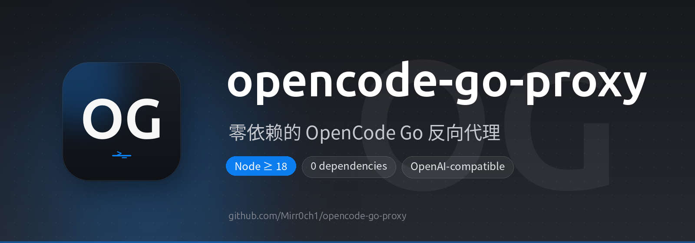
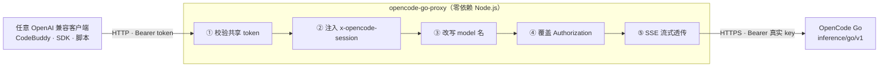

<p align="center">
  
</p>

<p align="center">
  
  
  
  
</p>

<p align="center">
  
  
  
  
</p>

<p align="center">
  
  
  
</p>

<p align="center">
  <b>中文</b> · <a href="./README-en.md">English</a>
</p>

<h1 align="center">opencode-go-proxy</h1>

<p align="center">
  <b>零依赖的 OpenCode Go 反向代理</b><br>
  <sub>让任意 OpenAI 兼容客户端都能用上你的 OpenCode Go 订阅。</sub>
</p>

---

## 目录

- [它是什么](#-它是什么)
- [为什么需要它](#-为什么需要它)
- [特性](#-特性)
- [架构](#-架构)
- [会话 ID 的三级回退](#-会话-id-的三级回退)
- [快速开始](#-快速开始)
- [配置](#-配置)
- [客户端接入](#-客户端接入)
- [systemd 部署](#-systemd-部署)
- [模型名改写](#-模型名改写)
- [排障](#-排障)
- [安全](#-安全)
- [许可证](#-许可证)

---

## ✨ 它是什么

一个**零依赖、单文件**的 Node.js 反向代理（`proxy.mjs`）。它把任意 OpenAI 兼容客户端转发到 [OpenCode Go](https://opencode.ai/go) 的公开推理端点，并自动补上大多数客户端做不到的两件事——**`x-opencode-session` 头注入**和**模型名改写**。

## 🎯 为什么需要它

自 **2026-09-05** 起，OpenCode Go API（`https://opencode.ai/inference/go/v1`）要求每个请求都携带 `x-opencode-session` 头，否则上游直接返回 `400 MissingSessionID`。这个头承担两个职责：

- **会话亲和**：同一会话的请求被固定到同一后端；
- **prompt 缓存路由**：`usage.cached_tokens` 命中时直接省订阅钱。

问题在于：很多支持"自定义 OpenAI 兼容模型"的客户端（CodeBuddy 的 `models.json`、裸 OpenAI SDK、各种 harness）只能设 `base_url` 和 `api_key`，**无法注入自定义头**——大多数都没有 `CUSTOM_HEADERS` 这样的逃生口。

这个代理就坐在中间，把这件事（以及几件配套的事）替客户端做了。

## 🛠️ 特性

- 🪶 **零依赖** —— 单文件 Node.js 脚本，无需 `npm install`
- 🧠 **`x-opencode-session` 注入** —— 带三级回退（见下文）
- 🔄 **模型名改写** —— 客户端可用别名（如 `deepseek-v4-pro-mine`），上游收到真实名字
- 🔑 **共享 token 鉴权** —— 真实订阅 key 不出代理主机，客户端只拿可轮换的 token
- 🔒 **密钥隔离** —— 代理用真实 key 覆盖客户端的 `Authorization` 头
- 📡 **SSE 流式透传** —— 响应透明转发
- 📝 **每请求日志** —— 状态码、耗时、会话 ID、模型改写；错误时附带上游 body 和请求摘要
- 🖥️ **systemd 友好** —— 日志走 stdout（journald），缺 token 拒绝启动

## 🏗️ 架构



## 🧠 会话 ID 的三级回退

`x-opencode-session` 的值按"稳定性从高到低"回退——目标是得到一个**稳定**的会话 ID（从而命中 prompt 缓存），而不是仅仅通过 400 校验：

1. **客户端提供的 ID** —— `X-Conversation-ID` / `X-Session-ID`，或已有的 `x-opencode-session` 头
2. **内容哈希** —— `sha256(system 消息 + 首条 user 消息)`。对不传会话 ID 的客户端，同一会话的多轮请求会得到**相同**的 ID（system + 首条 user 不会变），从而保住缓存亲和
3. **随机 UUID** —— 兜底；能过 400 校验，但每轮都变、无缓存命中

## 🚀 快速开始

```bash
# 1. 创建密钥文件（模板见 .env.example；systemd 部署请放到
#    ~/.config/opencode-go-proxy/opencode.env，见下方 systemd 一节）
cp .env.example opencode.env
#    填入 OPENCODE_GO_API_KEY（必填）和 PROXY_TOKEN（必填）

# 2. 运行
PROXY_TOKEN=... OPENCODE_GO_API_KEY=... node proxy.mjs

# 3. 让任意 OpenAI 兼容客户端指向它：
curl http://127.0.0.1:18999/chat/completions \
  -H "Authorization: Bearer $PROXY_TOKEN" \
  -H "Content-Type: application/json" \
  -d '{"model":"deepseek-v4.1-flash","messages":[{"role":"user","content":"hi"}],"max_tokens":64}'
```

## ⚙️ 配置

所有配置通过环境变量完成。

| 变量 | 必填 | 默认值 | 说明 |
|------|:---:|--------|------|
| `OPENCODE_GO_API_KEY` | ✅ | — | 你的真实 OpenCode Go 订阅 key。**绝不共享给客户端。** |
| `PROXY_TOKEN` | ✅ | — | 客户端以 `Authorization: Bearer <PROXY_TOKEN>` 呈现的 token。**缺失时代理拒绝启动。** |
| `PROXY_PORT` | — | `18999` | 监听端口 |
| `PROXY_BIND` | — | `0.0.0.0` | 绑定地址；仅本机可用时设 `127.0.0.1` |

## 🔌 客户端接入

任意 OpenAI 兼容客户端都能接入，只需配三样：

| 配置项 | 值 |
|--------|-----|
| `base_url` | `http://<代理主机>:<PROXY_PORT>` |
| `api_key` | `<PROXY_TOKEN>` |
| `model` | 上游真实模型名，或带 `-opencode` 后缀的别名（后缀会被剥掉） |

> 默认后缀是 `-opencode`。想改别名规则，编辑 `proxy.mjs` 里的 `SUFFIX` 常量即可。

**OpenAI SDK 示例：**

```python
from openai import OpenAI

client = OpenAI(
    base_url="http://127.0.0.1:18999",
    api_key="<PROXY_TOKEN>",
)

resp = client.chat.completions.create(
    model="deepseek-v4-pro",
    messages=[{"role": "user", "content": "你好"}],
)
print(resp.choices[0].message.content)
```

### CodeBuddy（models.json）

如果你用 CodeBuddy，在 `models.json` 里添加指向代理的自定义模型，并用带后缀的 id 以免覆盖内置模型：

```json
{
  "models": [
    {
      "id": "deepseek-v4-pro-opencode",
      "name": "DeepSeek V4 Pro (OpenCode Go)",
      "vendor": "opencode-go",
      "apiKey": "<PROXY_TOKEN>",
      "url": "http://127.0.0.1:18999/chat/completions",
      "maxInputTokens": 1000000,
      "maxOutputTokens": 384000,
      "supportsToolCall": true,
      "supportsReasoning": true
    }
  ]
}
```

然后用 `/model deepseek-v4-pro-opencode` 切换。

## 🖥️ systemd 部署

密钥放在私有的 XDG 配置目录（`~/.config/opencode-go-proxy/opencode.env`），与源码检出目录分离。

```ini
# ~/.config/systemd/user/opencode-go-proxy.service
[Unit]
Description=opencode-go-proxy (token-auth reverse proxy)
After=network-online.target
Wants=network-online.target

[Service]
Type=simple
WorkingDirectory=/path/to/opencode-go-proxy
EnvironmentFile=%h/.config/opencode-go-proxy/opencode.env
ExecStart=/usr/bin/node /path/to/opencode-go-proxy/proxy.mjs
Restart=always
RestartSec=2
TimeoutStopSec=10

# Hardening（user 服务安全的子集）。
# 有意省略（在 *user* 服务里会报 status=218/CAPABILITIES）：
#   NoNewPrivileges、ProtectKernel{Tunables,Modules}、ProtectControlGroups。
# 另省略：MemoryDenyWriteExecute（Node 的 V8 JIT 需要 W^X 内存）。
PrivateTmp=true
ProtectSystem=strict
ProtectHome=read-only
RestrictAddressFamilies=AF_INET AF_INET6
LockPersonality=true

[Install]
WantedBy=default.target
```

```bash
systemctl --user daemon-reload
systemctl --user enable --now opencode-go-proxy
```

> 代理默认不写任何文件（日志走 journald）。若需要写文件，在 `ProtectSystem=strict` 下加 `ReadWritePaths=` 指向具体目录。

## 🔄 模型名改写

代理转发前会剥掉请求体 `model` 字段的 `custom-local:` 前缀和 `-opencode` 后缀：

```
custom-local:deepseek-v4.1-flash-opencode  →  deepseek-v4.1-flash
deepseek-v4.1-flash                        →  deepseek-v4.1-flash  （透传）
```

这让你能在客户端用带后缀的别名（避免覆盖内置模型），同时上游收到真实名字。

## 🩺 排障

```bash
# 状态
systemctl --user status opencode-go-proxy

# 每请求日志（状态码、耗时、会话 ID、模型改写、错误 body）
journalctl --user -u opencode-go-proxy -n 30

# 重启
systemctl --user restart opencode-go-proxy
```

| 报错 | 含义 |
|------|------|
| `400 MissingSessionID` | 直连了上游、绕过了代理（代理会自动注入头） |
| `400 Model is unavailable` | ① 带后缀的模型名没走代理改写；② 上游瞬时故障（约 1 分钟，自动恢复） |
| `401 unauthorized` | `PROXY_TOKEN` 缺失或不正确 |

## 🔒 安全

- **真实订阅 key 只存在代理主机的密钥文件里**（chmod 600，如 `~/.config/opencode-go-proxy/opencode.env`），客户端只持有可轮换的 `PROXY_TOKEN`。
- **轮换 token** = 改密钥文件里的 `PROXY_TOKEN` + 重启 + 更新客户端；**轮换真实 key** = 去 OpenCode 控制台操作 + 更新密钥文件。
- 客户端 → 代理段默认是**明文 HTTP**（未加密）。跨网络暴露时请走加密通道（Tailscale / WireGuard）或在前端加 TLS。
- 代理**在缺少 `PROXY_TOKEN` 时拒绝启动**——宁可快速失败，也不把额度裸奔暴露到网络上。

## 📄 许可证

[MIT](./LICENSE)
